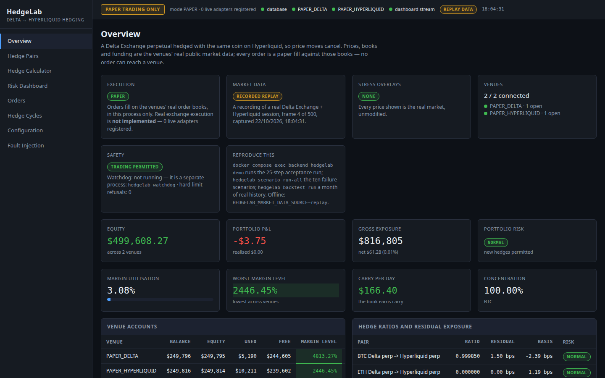
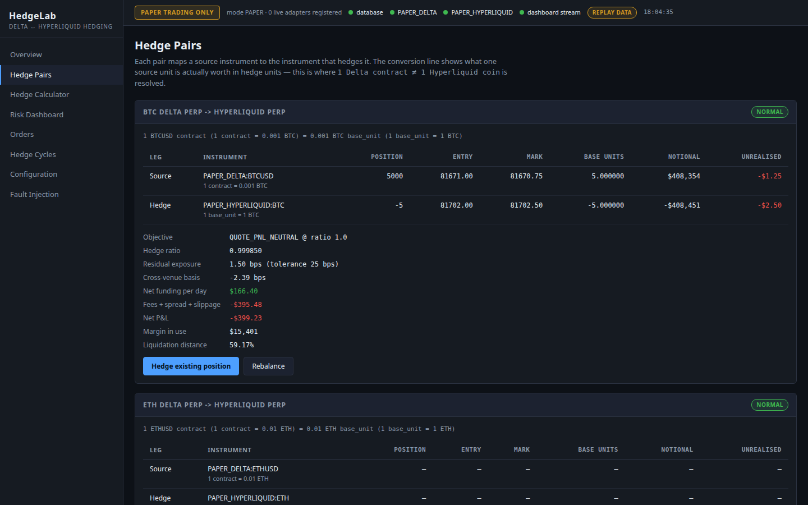
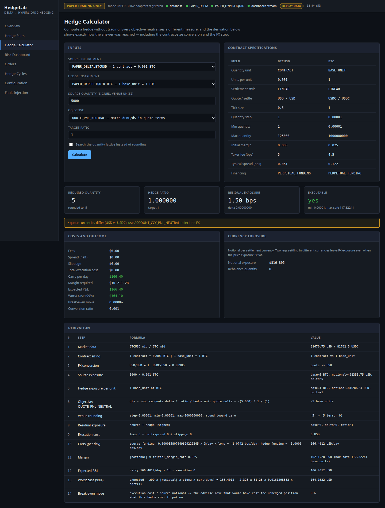
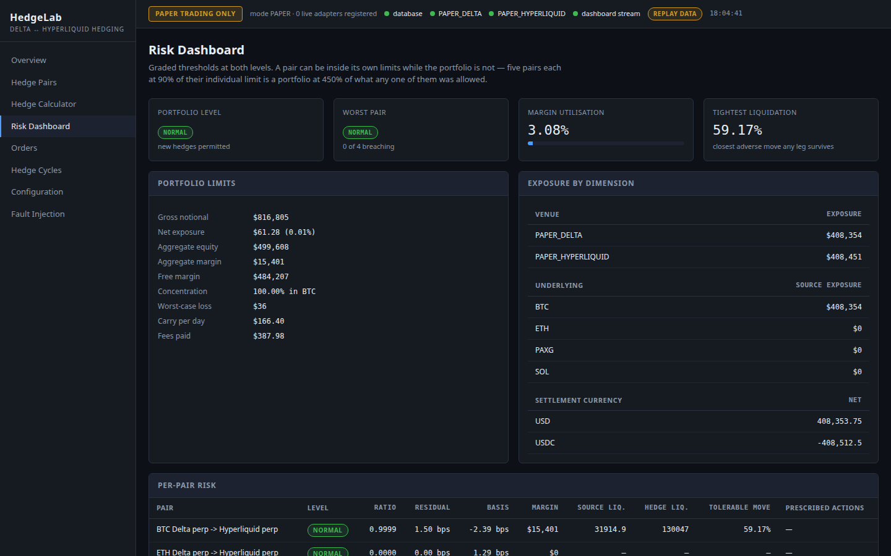
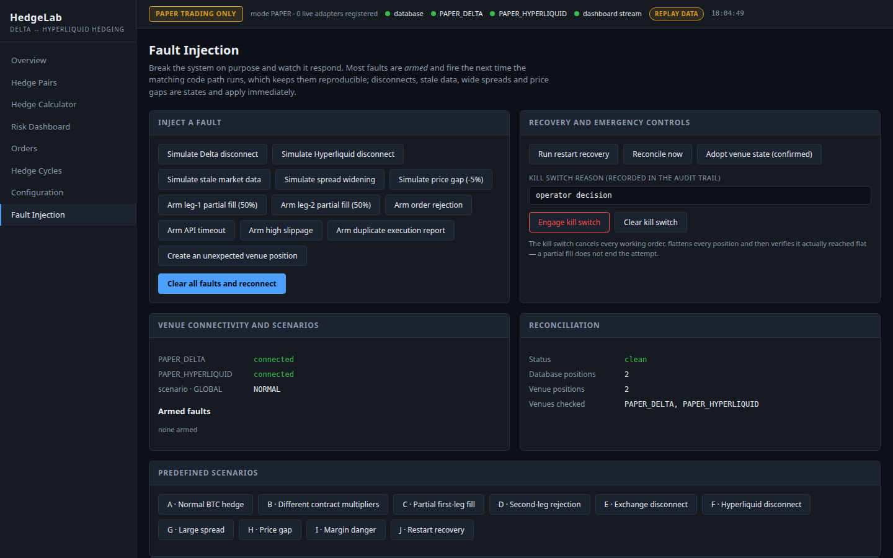

# Crypto Cross-Exchange Hedging Engine | Delta-Neutral Trading Infrastructure

**An open-source crypto cross-exchange hedging engine that holds a perpetual
futures position on Delta Exchange and the exactly offsetting position on
Hyperliquid — with hedge-ratio calculation, funding-rate analytics, paper
execution against real order books, risk controls and recovery testing.**

> **PAPER TRADING ONLY.** No real order can leave this software: the live
> exchange adapters raise on every call, the venue factory builds only paper
> venues, and no setting holds a credential. Market data, on the other hand, is
> **real** — Delta Exchange (India) and Hyperliquid public APIs, live or
> replayed from a recording.

[](https://github.com/pranay123-stack/cross-venue-delta-neutral-hedging-engine/actions/workflows/ci.yml)


[](LICENSE)



---

## Contents

[The problem](#the-engineering-problem) ·
[Features](#feature-highlights) ·
[Architecture](#architecture) ·
[A hedge, worked](#a-hedge-calculated-step-by-step) ·
[Risk and recovery](#risk-controls-and-failure-recovery) ·
[Screenshots](#screenshots) ·
[Quick start](#quick-start) ·
[Demo](#demo-commands-and-expected-results) ·
[Testing](#testing-and-benchmark-methodology) ·
[Backtest](#backtest-on-real-history) ·
[Design decisions](#engineering-design-decisions) ·
[API and CLI](#api-and-cli) ·
[Roadmap](#roadmap-and-non-goals) ·
[Contributing](#contributing) ·
[Security](#security-and-responsible-use) ·
[License](#license) ·
[Collaboration](#collaboration)

---

## The engineering problem

A **delta-neutral crypto** position is long a coin on one exchange and short
the same coin on another, so price moves cancel. People run it to protect a
position that has to stay where it is, to earn the difference in **funding
rates** between venues, or to hold **cross-exchange basis** exposure without
outright price risk.

It sounds like "buy here, sell there". It is not, because the two exchanges
describe the same economic position in incompatible ways:

| | Delta Exchange (India) | Hyperliquid |
|---|---|---|
| Quantity | contracts of 0.001 BTC | coins, step 0.00001 BTC |
| Funding | **percent** per **8 h** (4 h for PAXG) | **fraction** per **hour** |
| Settlement | USD | USDC |
| Price tick | fixed 0.5 | five significant figures — changes with price |
| Margin | 0.5 % to $100k, **rising with position size** | 1 / max leverage |
| Minimum order | 1 contract | $10 |
| Order types | `gtc`, `ioc` | `Alo`, `Ioc`, `Gtc`; no fill-or-kill on either |

Get any of these wrong and the hedge is wrong: matching "5000" to "5000" is a
1000× over-hedge; comparing raw funding fields misreads Hyperliquid by 100× in
units and 8× in time; a flat 0.5 % margin makes an $8M position look like it
needs $41k when it needs $1.69M. And two exchanges cannot be traded atomically —
the first leg can fill while the second is rejected, times out, or the process
dies in between.

This repository is the infrastructure that makes such a hedge correct and safe.
The full account is in the [engineering case study](docs/ENGINEERING_CASE_STUDY.md).

## Feature highlights

* **Real market data, live or replayed** — order books, mark prices and funding
  from Delta Exchange and Hyperliquid; stablecoin FX from Kraken. A recorded
  live session replays deterministically for tests and offline demos.
* **Exchange specs generated from the venues' own metadata** — contract value,
  tick, size decimals, fees, margin schedule, funding interval, venue ids.
* **Hedge ratio calculation** under nine objectives (coin-, notional- and
  P&L-neutral, funding- and cost-adjusted, β-weighted), each with a 14-step
  derivation, plus a lattice-aware quantity optimiser.
* **Paper execution** — a supervised two-leg cycle (sixteen persisted states)
  filling against the real order books, with recovery from rejection, partial
  fills, timeouts, disconnects and restarts.
* **Crypto risk management** — per-pair and portfolio ladders, size-based
  margin and liquidation, and a kill switch that verifies flat and survives a
  restart.
* **Live-readiness safety layer** — hard limits in front of every venue, rate
  limiting with backoff, an order-independent fill ledger, venue-native dry-run
  payloads, fill- and funding-level reconciliation, and an **independent
  watchdog** process.
* **Funding-rate analytics and backtesting** on 30 days of real hourly closes
  and settled funding, with price impact measured on recorded books.
* **A React dashboard**, a FastAPI service with OpenAPI, a CLI, Docker Compose.

## Architecture

```
            Delta /v2 tickers + l2orderbook     Hyperliquid metaAndAssetCtxs + l2Book     Kraken USDC/USD
                              └─────────────────────────┬──────────────────────────────────┘
                                                        ▼
                         collector ─▶ market frame (units normalised) ─▶ MarketFeed (+ labelled stress overlays)
                                         │ record / replay                     │
              ┌──────────────────────────┴───────────┬──────────────────────────┼──────────────────────┐
              ▼                                      ▼                          ▼                      ▼
     statistics (vol, ρ, β)        hedge engine: convert ─▶ objectives ─▶     paper venues        dashboard
                                   optimiser ─▶ risk gate                     (real books)        (WebSocket)
                                             │                                    ▲
                                             ▼                                    │
                     hard-limit guard + dry-run payload ─▶ 16-state two-leg coordinator ─▶ recovery
                                                                   │ write-ahead
                                                                   ▼
                                   PostgreSQL ─▶ reconciliation (positions, fills, funding) ─▶ P&L attribution
                                       ▲
             watchdog (separate process): API heartbeat stops ─▶ flatten, verify flat, persist kill switch
```

The calculation core — `domain/`, `hedge/`, `risk/`, `costs/` — is pure Python
with no network or database access, so identical code runs live, on a replay,
in the backtest and in tests. Only `marketdata/sources.py` touches the network,
through public read-only endpoints. Module-by-module rationale is in
[ARCHITECTURE.md](docs/ARCHITECTURE.md).

## A hedge, calculated step by step

One real hedge, every number produced by the engine on the recorded Delta +
Hyperliquid session (22 Oct 2026, 12:35 UTC). **The full walkthrough —
objectives, venue payloads, a −10 % crash and funding — is in
[How the hedging engine works](docs/HOW_A_HEDGE_WORKS.md).**

**The position:** 5,000 BTCUSD contracts long on Delta Exchange. **The goal:**
the exactly offsetting position on Hyperliquid.

| # | Step | What the engine does | Result |
|---|---|---|---|
| 1 | **Read the market** | Delta mid 81,653.25 USD · Hyperliquid mid 81,685.5 USDC · USDC/USD 0.99985 | one normalised snapshot |
| 2 | **Translate units** | 5,000 contracts × 0.001 BTC | **5 BTC** — not "5,000" (a 1,000× error) |
| 3 | **Measure exposure** | 5 BTC × 81,653.25 | **$408,266** notional, delta 5 |
| 4 | **Choose "neutral"** | quote-P&L neutral (8 other objectives give −4.88 to −5.00075 BTC) | **−5 BTC** |
| 5 | **Fit venue rules** | 0.00001 BTC step, round toward zero, $10 minimum | −5.00000, no rounding error |
| 6 | **Price it first** | 4.5 bps taker fee + half spread · margin at 40× · funding at current rates | cost **$186**, margin **$10.2k**, carry **+$166/day** |
| 7 | **Check safety** | risk gate · hard limits · exact exchange orders built and validated | both orders sendable |
| 8 | **Execute two legs** | Delta BUY 5,000 @ 81,653.5 → Hyperliquid SELL 5 BTC @ 81,685, leg 2 sized from leg 1's fill | `… → BOTH_FILLED → COMPLETED` |
| 9 | **Result** | hedge ratio 0.99985 | residual **1.50 bps** = 5 BTC × (1 − 0.99985) |

**Then BTC falls 10 %** (81,669 → 73,503):

```
Delta leg            −$40,827.50
Hyperliquid leg      +$40,840.00
fees, spread, FX      −$405.27   (unchanged by the move, apart from $10 of FX and spread)
─────────────────────────────────
the book moved by     +$6.38      on a $40,800 swing per leg
```

The two legs live on different exchanges, so the engine also watches each
venue's margin on its own: after the drop Delta's equity is down $40.8k while
Hyperliquid's is up — the book is flat, but each account must stay solvent.

## Risk controls and failure recovery

| Failure | What the engine does | Verified by |
|---|---|---|
| Second leg rejected | `RECOVERY_REQUIRED → REBALANCING → COMPLETED`, residual 1.50 bps | scenario D, `test_leg_two_rejection_recovers_automatically` |
| First leg partially filled | Hedge sized from what filled (3000 → 3 BTC), not what was asked | scenario C |
| Second leg partially filled | Shortfall detected and traded away | `test_leg_two_partial_fill_triggers_a_rebalance` |
| Request times out | Venue queried by client order id — never blindly retried | `test_timeout_does_not_double_hedge` |
| Venue disconnects | Cycle refused before taking exposure | scenarios E, F |
| Spread blows out / data stale | Refused on execution-quality grounds | scenario G |
| 15 % adverse move on a levered book | Margin level 432 % → 68 %, risk ladder to KILL_SWITCH | scenario I |
| Process restarts mid-cycle | Rebuilt from the database, reconciled, resumed only if unambiguous | scenario J |
| API process dies with a hedge open | Watchdog flattens in ~35 s; restarted API refuses to trade | Docker crash drill |

Hard limits (max order and position notional, daily loss per venue, orders per
minute) sit in front of every venue; orders that only reduce exposure always
pass, so the book can always be flattened. Details:
[RISK_ENGINE.md](docs/RISK_ENGINE.md), [FAILURE_RECOVERY.md](docs/FAILURE_RECOVERY.md).

## Screenshots

Captured from the running application on the recorded Delta + Hyperliquid
session (`make screenshots`), with a hedged BTC position opened through the API.

| | |
|---|---|
|  |  |
| **Hedge pairs** — both legs, ratio, residual, basis, funding and costs | **Hedge calculator** — the full derivation behind a hedge size |
|  |  |
| **Risk dashboard** — thresholds, margin and limits | **Fault injection** — break it on purpose and watch it recover |

## Quick start

```bash
git clone https://github.com/pranay123-stack/cross-venue-delta-neutral-hedging-engine
cd cross-venue-delta-neutral-hedging-engine
cp .env.example .env
docker compose up --build
```

Dashboard <http://localhost:5174> · API docs <http://localhost:8001/docs>. The
backend polls both exchanges every 3 seconds (no API keys — the data is public)
and a separate **watchdog** container guards the book. Offline, or if a venue is
unreachable: `HEDGELAB_MARKET_DATA_SOURCE=replay docker compose up --build`.

Without Docker (Python 3.12, Node 20):

```bash
make install     # backend venv with pinned versions + frontend packages
make check       # lint, strict types, tests, frontend build, browser tests
```

## Demo commands and expected results

| Command | What it does | Expected |
|---|---|---|
| `docker compose exec backend hedgelab demo` | 25-step acceptance run on live data | `25/25 steps passed` |
| `make demo` | the same, offline on the recorded session | `25/25 steps passed` |
| `docker compose exec backend hedgelab scenario run-all` | ten failure scenarios | `10/10 scenarios passed` |
| `docker compose exec backend hedgelab instruments pairs` | the four pairs and their unit conversions | `1 BTCUSD contract … = 0.001 BTC …` |
| `make backtest` | 30 days of real history, impact from recorded books | a table like the one below |

## Testing and benchmark methodology

| Check | Result | How it is measured |
|---|---|---|
| Backend tests | **598 passed**, offline | `make test` — unit, Hypothesis property tests, integration, API contract, WebSocket. A fixture fails any test that touches the network; inputs are committed recordings of the real venues |
| Browser tests | **10 passed** | `make e2e` — Playwright on Chrome against the real API and dashboard on replay data |
| Coverage | **88 %** overall, 93–100 % on the calculation core | `pytest --cov` |
| Lint / types | ruff clean · mypy strict clean (86 files) · tsc clean | `make lint typecheck` |
| Acceptance / scenarios | 25/25 · 10/10, on replay and live in Docker | `hedgelab demo`, `scenario run-all` |
| Clean install | pinned install from scratch (as CI does) passes lint, types and the full suite | `pip install -c backend/requirements-lock.txt -e ".[dev]"` |
| HTTP throughput | 219 req/s at 50 clients, 154 req/s at 200 — **0 errors** at both | `backend/scripts/load_test.py` against one replay-mode process on SQLite, on a laptop CPU in `powersave` (~1 GHz); absolute rates are machine-specific |

**What the throughput figure is — and is not.** It measures how many dashboard
and API *reads* (market data, positions, risk, hedge calculations) one Python
process serves. It is **not** market-data latency (the feed polls every 3 s)
and **not** trade-execution latency (no real orders are sent). At 200 clients
nothing fails, but database-backed endpoints reach ~3 s p99 and the price loop,
which shares the event loop, refreshes less often.

Mutation checks confirm the key tests can fail: breaking the rounding, the fill
ledger's ordering, overlay clearing, or kill-switch persistence each turns a
test red. The bugs these tests and real data found are listed in
[TESTING.md](docs/TESTING.md).

## Backtest on real history

**What was run:** long 1000 BTCUSD contracts (1 BTC) on Delta Exchange, hedged
with Hyperliquid BTC, at three hedge ratios.

| Hedge ratio | Price drawdown removed | Net P&L | Funding | Fees | Spread cost |
|---|---|---|---|---|---|
| 1.00 (full) | **98.3 %** | +$275.87 | +$302.84 | $81.73 | $0.79 |
| 0.50 | **50.6 %** | −$2,165.74 | +$21.00 | $62.37 | $0.52 |
| ~0.00 (none) | **0.0 %** | −$4,606.87 | −$260.78 | $43.01 | $0.26 |

* **Interval:** 719 hourly steps, 2026-09-22 12:00 → 2026-10-22 11:00 UTC.
* **Prices:** hourly candle closes from Delta's `/v2/history/candles` and
  Hyperliquid's `candleSnapshot`, on timestamps both venues printed. Closes are
  traded prices, not mids.
* **Funding:** each venue's *settled* rates (Delta `FUNDING:` candles,
  Hyperliquid `fundingHistory`), charged on the venue's own clock at UTC
  multiples of its interval — Delta's 00/08/16 UTC schedule is confirmed against
  its own history.
* **Fees:** base-tier taker fees, 5 bps Delta and 4.5 bps Hyperliquid, on entry
  and on rebalances. **Exit costs are not charged.**
* **Slippage:** half the spread measured when the specs were generated, or —
  with `--books` — the median cost of sweeping the 500 recorded order books.
* **FX:** USDC/USD measured from Kraken when the backtest runs, held constant.

Risk reduction tracking the hedge ratio linearly is the correctness check. The
full hedge earned carry in this month for a specific reason: Delta's BTC
funding averaged +0.0035 % per 8 h, so the long Delta leg **paid $261**, while
Hyperliquid's rate sat at its 0.00125 %/h baseline 59 % of the time, so the
short leg **received $564**. **This is one month of one pair — a measurement of
the past, not a forecast and not evidence of a profitable strategy.** Funding
rates change sign, and a displayed funding spread is not realised carry.

Reproduce: `make backtest`, or
`hedgelab backtest run --history backend/tests/data/history.json.gz --ratio 0.5`.

## Engineering design decisions

* **Decimal for money and quantities.** Exchange lattices are decimal; binary
  floats produce rejected orders. Floats appear only in the statistics module.
* **Write-ahead state machine.** Each transition is persisted before its side
  effect, which is what lets restart recovery tell "submitted, outcome unknown"
  from "never sent".
* **Units normalised at the edge, once.** Funding, quantities and settlement
  currencies are converted in the venue clients; nothing downstream compares raw
  venue fields.
* **Specs generated from the venues, not typed in.** Venue behaviour lives in
  data; the engine never branches on a symbol.
* **Real recordings instead of a price simulator.** The switch from a simulator
  exposed bugs it had hidden — see the [case study](docs/ENGINEERING_CASE_STUDY.md#trade-offs).
* **Stress as labelled overlays.** Crashes and spread blow-outs are applied on
  top of the real book and shown as hypothetical, never mixed into the data.
* **Safety below the strategy.** Hard limits wrap every venue; the watchdog is a
  separate process that shares only the database.
* **One process owns the book.** Two coordinators would both trade the same
  residual; multi-process operation needs leader election first.

## API and CLI

* **REST + WebSocket API** — 60 paths, explored in **Swagger UI at `/docs`**,
  where every operation shows a real recorded request and its real success and
  error responses (kept true by a contract test): hedge calculation,
  optimisation and execution, risk and portfolio, P&L and funding, market feed
  and stress overlays, fault injection, reconciliation, dry-run orders,
  scenarios, backtests, system status. Reference: [API.md](docs/API.md).
* **CLI** — `hedgelab demo | scenario | calculate | optimize | backtest |
  instruments sync | market record | market history | watchdog | serve`.
  Run `hedgelab --help`; every `make` target is listed by `make help`.
* **Configuration** — `HEDGELAB_*` environment variables:
  [DEPLOYMENT.md](docs/DEPLOYMENT.md).

## Roadmap and non-goals

Next: testnet adapters for both exchanges, reconciliation against authenticated
account state, shadow execution on live data, execution telemetry, and a
recording of a real volatile market. Full priorities and acceptance criteria:
[ROADMAP.md](docs/ROADMAP.md).

**Non-goals:** high-frequency arbitrage (it polls every 3 s and holds positions
for hours to weeks); deciding *when* to trade (it hedges what you ask it to);
live trading by default; synthetic market data.

**Limitations, plainly:** no signed live order adapters; paper fills cross the
real book instantly with no queue position or matching latency; one calm
17-minute recording and 30 days of hourly history; Hyperliquid's tiered margin
and both venues' fee tiers flattened to the base tier; Delta's margin scaling
follows ccxt's formula rather than Delta's own page; single process.

## Contributing

Setup, ground rules (real data only, no live trading path, never weaken a risk
control, a test for every behaviour change) and the pull-request checklist are
in [CONTRIBUTING.md](CONTRIBUTING.md). CI runs ruff, strict mypy, the backend
suite, the frontend build, the browser tests and a dependency audit.

## Security and responsible use

The software holds no credentials and can place no real order. Report
vulnerabilities privately as described in [SECURITY.md](SECURITY.md), which also
covers what to change before extending it towards live trading. Backtest and
paper results describe the recorded past; nothing here is investment advice,
and trading these derivatives may be restricted where you live.

## License

[MIT](LICENSE).

## Collaboration

This engine is a foundation for further work: authenticated and testnet
exchange integrations, more venues, funding and basis analytics, execution
quality analysis, reconciliation against real account statements, or a review
of your own hedging infrastructure. What is implemented, what is extension
work, and what still needs research is laid out in
[COLLABORATION.md](docs/COLLABORATION.md).

To discuss it, open an issue or reach out through
[github.com/pranay123-stack](https://github.com/pranay123-stack).

---

**Documentation:** [How a hedge works](docs/HOW_A_HEDGE_WORKS.md) ·
[Case study](docs/ENGINEERING_CASE_STUDY.md) ·
[Architecture](docs/ARCHITECTURE.md) · [Hedge engine](docs/HEDGE_ENGINE.md) ·
[Execution](docs/EXECUTION_ENGINE.md) · [Risk](docs/RISK_ENGINE.md) ·
[Failure recovery](docs/FAILURE_RECOVERY.md) · [Paper trading](docs/PAPER_TRADING.md) ·
[Database](docs/DATABASE.md) · [API](docs/API.md) · [Testing](docs/TESTING.md) ·
[Deployment](docs/DEPLOYMENT.md) · [Demo script](docs/DEMO_SCRIPT.md) ·
[Roadmap](docs/ROADMAP.md) · [Collaboration](docs/COLLABORATION.md) ·
[Project status](PROJECT_STATUS.md)
